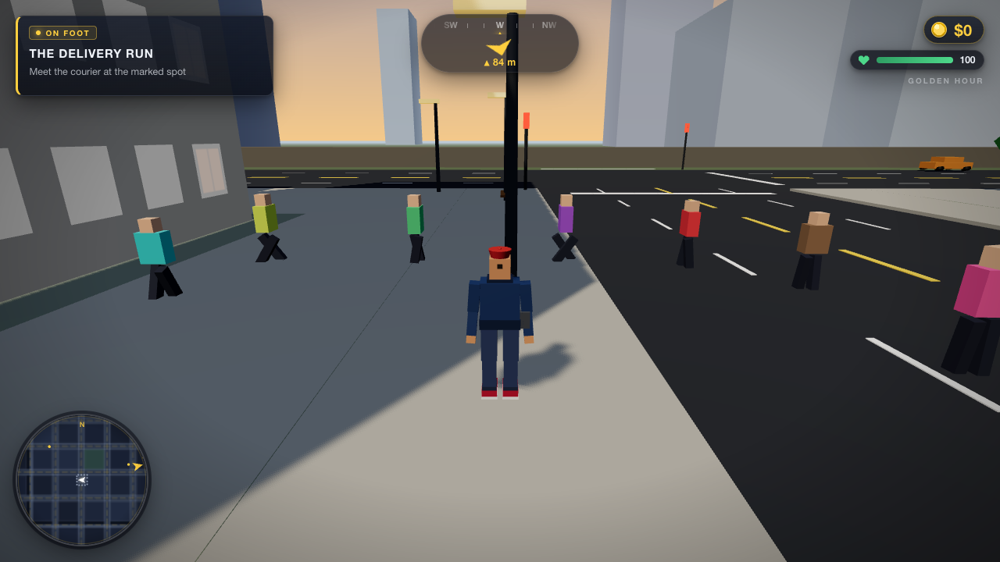
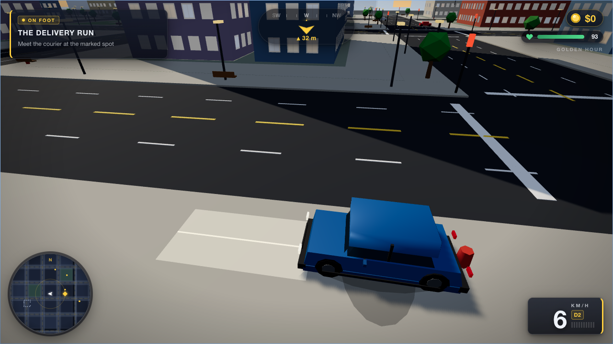
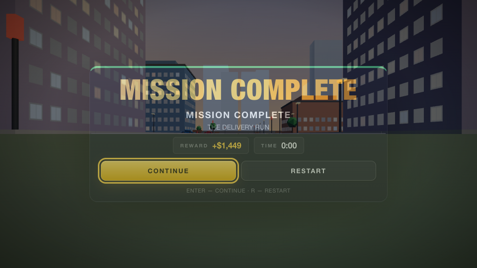
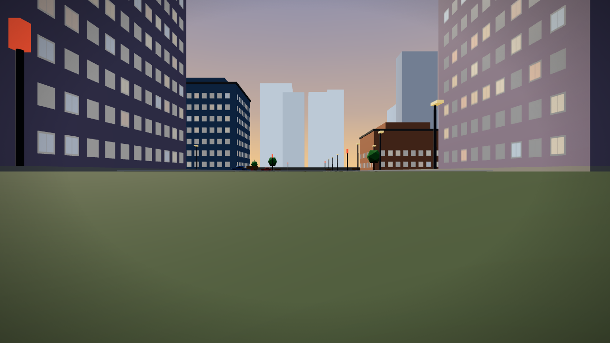

# MINI GTA — OPEN CITY

A compact, third-person, open-city action game that runs in your browser. Walk the streets, jack a car, and complete **The Delivery Run** before the clock runs out.

No account, no install, no plugins. Just open the page and press **PLAY**.

| Start street | Driving |
|---|---|
|  |  |

| Mission complete | Pause (WebKit / Safari engine) |
|---|---|
|  |  |

 

## Play it

- **Online:** open the URL in `PLAY.txt` / your deployment (see [docs/DEPLOYMENT.md](docs/DEPLOYMENT.md)).
- **Locally, without Node:** unzip `MINI-GTA-OPEN-CITY-v1.0.0.zip`, then either
  - double-click `dist/index.html` (works in Chrome and Safari — the build uses relative paths), or
  - for the most faithful experience, serve the folder: `cd dist && python3 -m http.server 8000` and open <http://localhost:8000>.
- **From source:** `npm install && npm run dev` → <http://127.0.0.1:5173>.

## Controls

| Key | On foot | Driving |
|---|---|---|
| **W A S D** | Move | Accelerate / steer / brake-reverse |
| **Mouse** | Orbit camera | Orbit camera (auto-trails the car) |
| **Shift** | Sprint | — |
| **Space** | Jump | Handbrake |
| **E** | Enter the nearest vehicle (walk up to a car or traffic car) | Exit (you step out beside the car) |
| **Esc / P** | Pause | Pause |
| **R** | Restart the delivery run | Restart the delivery run |
| **M** | Mute | Mute |
| **F3** | Performance overlay (optional) | Same |

Click the game view once to capture the mouse (pointer lock). Press **Esc** to release it — the game pauses automatically.

## The Delivery Run

1. Walk to the gold marker and meet the courier.
2. Get into any vehicle (one is parked right next to you; you can also jack a moving car).
3. Drive to the drop-off downtown before the 90-second timer expires — the marker, the minimap diamond and the compass arrow all point the way.
4. Stop inside the drop-off zone to deliver. Faster deliveries pay more: **$1,000 base + $5 per second left**.
5. Continue free-roaming, or press **R** to run it again (your money carries over).

## Features

- **City:** 5 × 5 street grid (10 streets, 25 intersections), 21 procedurally placed buildings, a central park with fountain and trees, a parking lot, streetlights, traffic lights, benches, billboards and a distant skyline.
- **Player:** low-poly avatar with procedural walk/run/jump animation, sprint, jumping, circle-vs-box collision, kerb stepping.
- **Vehicles:** three drivable types with different handling (sedan, sport, van), arcade physics with drift, handbrake, brake lights, suspension pitch/roll, wheel spin, and tunnelling-proof swept collision. Cars can be entered, exited and jacked.
- **Traffic & pedestrians:** 9 traffic cars follow a right-hand-traffic lane graph with turn arcs and avoid each other; 14 pedestrians walk pavement loops and step aside.
- **Mission:** fully scripted state machine, timers, rewards, win/fail screens, restart.
- **HUD:** money, health, mission panel with timer, compass + waypoint distance, speedometer, circular minimap with live dots, toasts, mission result overlay.
- **Audio:** procedurally synthesised (WebAudio) engine drone and effects — no audio files.

## Development

```bash
npm install          # dependencies
npm run dev          # dev server (HMR)
npm run typecheck    # TypeScript, strict
npm test             # unit tests (Vitest)
npm run test:e2e     # browser tests (Playwright: Chromium + WebKit/Safari engine)
npm run build        # typecheck + production build into dist/
npm run preview      # serve dist/ on http://127.0.0.1:4173
npm run package      # build + create release/MINI-GTA-OPEN-CITY-v1.0.0.zip
```

### Project structure

```
src/
  contracts.ts      Frozen interfaces shared by all modules
  main.ts           Bootstrap + error screen + pointer-lock gesture
  core/             engine (renderer, fixed-step loop), input, camera, audio, perf probe
  world/            layout constants, road graph, city renderer, collision grid, windows
  entities/         player controller/avatar, vehicle models, arcade vehicle physics
  gameplay/         pedestrians + traffic AI, mission, game state (money/health)
  game/             game orchestration/state machine, sky + sun rigs, vehicle detail
  ui/               HUD (canvas minimap, toasts, result), menus (start/controls/pause), CSS
tests/unit/         Vitest (physics, mission, NPC bounds, ...)
tests/e2e/          Playwright (boot, menus, HUD, controls, vehicles, mission, pause, perf, production)
docs/               controls, deployment, QA report, manual checklist
```

## Browser support

- **Chrome / Edge / Firefox:** recent versions with WebGL2 (falls back to WebGL1 where available).
- **Safari (macOS):** verified with the WebKit engine used by Safari (see [TEST_RESULTS.md](TEST_RESULTS.md)).
- Requires hardware acceleration; the page shows a friendly message if WebGL is unavailable.
- No network calls at runtime: every asset is procedural or bundled.

## Known limitations

See the **Known limitations** section of [TEST_RESULTS.md](TEST_RESULTS.md). Highlights: one mission, no combat, no saves, keyboard+mouse only (no gamepad/touch), simplified box-based collision.

## Credits & licence

Built with [Three.js](https://threejs.org), [Vite](https://vite.dev), TypeScript, Vitest and Playwright. All geometry and sound are generated procedurally at runtime; no third-party assets are bundled. MIT licence — see [LICENSE](LICENSE).
